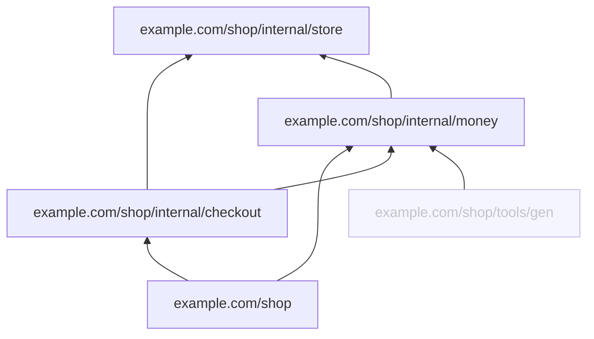

### zu · structural change

base bbbbbbbbbbbb (merge-base) → head hhhhhhhhhhhh

4 packages changed: +0 ~5 −1 declarations, 2 dependency changes, 1 move

| Package | Change | + ~ − | Hops |
|---|---|---|---|
| `example.com/shop/internal/store` | modified | +0 ~3 −1 | 0 |
| `example.com/shop/internal/money` | modified | +0 ~0 −0 | 0 |
| `example.com/shop/internal/checkout` | modified | +0 ~1 −0 | 0 |
| `example.com/shop` | modified | +0 ~1 −0 | 0 |

**Dependencies**

- + `example.com/shop` → `example.com/shop/internal/money`
- ⇄ `example.com/shop/internal/money` → `example.com/shop/internal/store` (reversed)

**Moves**

- `example.com/shop/internal/money.Add` → `example.com/shop/internal/money.Plus` (function)

Affected: 5 packages (4 changed, 1 at 1 hop)

Calls: +0 −2 · Embeds: +0 −1

Parse errors: base 0, head 0

Not compared: go.mod changes (dependency versions, go and toolchain lines) and other languages' toolchain and dependency files.
